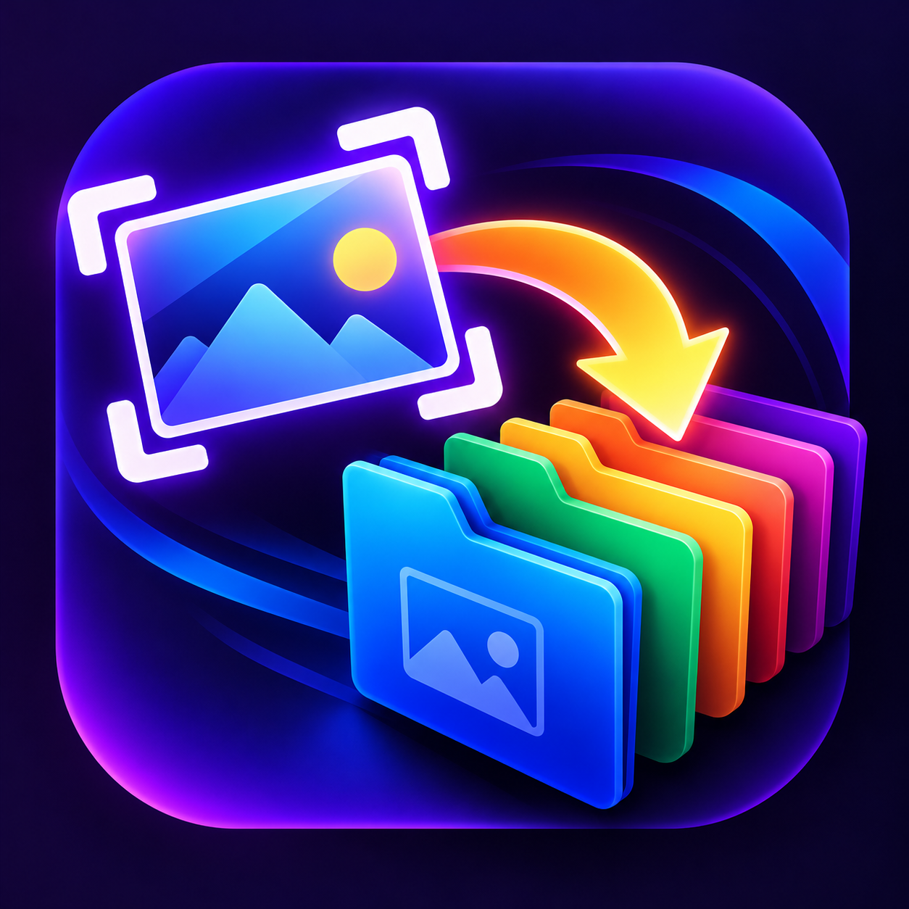

<p align="center">
  
</p>

<h1 align="center">Screenshot Director</h1>

<p align="center">
  <b>Instant, intelligent screenshot routing & lossless organization for Windows 10 & 11</b>
</p>

<p align="center">
  <a href="https://github.com/diaba1445-glitch/Screenshot-Director/releases/latest/download/ScreenshotDirector.exe"></a>
  <a href="https://github.com/diaba1445-glitch/Screenshot-Director/releases"></a>
  <a href="https://github.com/diaba1445-glitch/Screenshot-Director"></a>
  <a href="LICENSE"></a>
</p>

**Screenshot Director** is a lightweight, native Windows desktop utility that streamlines and automates screenshot management. Instead of letting captures clutter your clipboard or generic `Pictures\Screenshots` folder, Screenshot Director intercepts screenshots and displays a compact, instant destination routing popup right near your cursor or screen anchor.

With a single keypress (`1`–`9`) or click, your screenshot is encoded as a lossless PNG, saved to your desired folder, and its absolute file path is placed onto the clipboard ready to paste into Slack, Discord, email, or your browser.

---

## ⚡ Quick Download & Run (Windows 10 / 11)

1. **[Download ScreenshotDirector.exe](https://github.com/diaba1445-glitch/Screenshot-Director/releases/latest/download/ScreenshotDirector.exe)** (starts the download immediately; always the latest version). Prefer a zip? [Download the v1.0.7 zip](https://github.com/diaba1445-glitch/Screenshot-Director/releases/download/v1.0.7/ScreenshotDirector-v1.0.7-win-x64.zip) or browse all [releases](https://github.com/diaba1445-glitch/Screenshot-Director/releases).
2. Run **`ScreenshotDirector.exe`** (extract it first if you downloaded the zip).
3. **No installation required**: It runs as a self-contained single file with the .NET 8 runtime bundled in.

---

## 🚀 Key Features

- **Modern Control Center (Sidebar Navigation)**:

  - Clean, dark violet theme matching modern productivity tools.
  - **Home**: Live listening status, quick popup test, and recent captures feed with direct `[ 📄 Open file ]` and `[ 📂 Open folder ]` actions.
  - **Presets**: Map destination folders to keys `1`–`9` with reordering, templates (`+ Screenshots`, `+ Desktop`, `+ Downloads`), and custom browse.
  - **Popup & Routing**: Configure screen anchor positions (*TopRight* default, *BottomRight*, *BottomCenter*, *CursorAdjacent*), auto-dismiss timeout, and Session Default folder.
  - **General**: Per-user Windows startup toggle (`HKCU` Run key, no admin rights required), system tray minimization, and single-instance mutex enforcement.
  - **About**: Shortcut cheat sheet and release information.
- **Instant Routing Popup**:

  - Automatically triggered upon taking a screenshot with `Win + Shift + S`, Windows Snipping Tool, or `PrtScn`.
  - Opens as a compact card (header + preview) and reveals the destination tiles, custom-path drawer and footer on hover, so it stays out of the way until you need it.
  - Keys `1`–`9` instantly save to preset destinations.
  - Key `S` opens **Select Custom Path** to route to any unlisted folder with an option to add it to presets.
  - Key `R` focuses the **Quick Rename** box and automatically pauses the dismiss timer.
  - **Session Default Folder**: Option to remember choice so future screenshots auto-route with a quick 3-second collapsed toast without interrupting your flow. Press `E` on the toast to expand for exceptions, or click `Clear Default`.
  - **Global Escape**: While the popup is visible, pressing `Esc` dismisses it even when you have clicked into another app.
- **Built-in Snipping & Markup Tool**:

  - Crop, pen, highlighter, arrows, shapes, text, and pixelate redaction.
  - Cursor-anchored Ctrl+wheel zoom, fit-to-window, undo/redo, quick save, and copy.
  - Unedited images pass through untouched; annotated exports preserve the original pixel resolution and DPI.
- **Lossless PNG Engine**:

  - Thread-safe, non-blocking asynchronous PNG encoding.
  - Collision avoidance with automatic numbered suffixes (`Screenshot_2026-10-25_15-30-00 (1).png`).
  - Path traversal and invalid character sanitation.
  - Self-clipboard suppression to prevent infinite feedback loops.

---

## ⌨️ Keyboard Shortcuts Reference

| Shortcut                 | Action in Routing Popup                                  |
| :----------------------- | :------------------------------------------------------- |
| **`1` – `9`** | Instant save to corresponding preset destination folder  |
| **`S`**          | Select custom destination folder                         |
| **`R`**          | Focus rename field and pause auto-dismiss timer          |
| **`E`**          | Expand session default collapsed toast to full tile grid |
| **`Enter`**      | Confirm custom path or rename                            |
| **`Escape`**     | Dismiss popup without saving (works globally)            |

---

## 🛠 Technology Stack

- **Platform**: Windows 10 / Windows 11 (x64)
- **Framework**: .NET 8 (WPF + Windows Forms NotifyIcon)
- **Architecture**: Model-View-ViewModel (MVVM)
- **Native APIs**: Win32 User32 P/Invoke (`AddClipboardFormatListener`, `GetCursorPos`, `MonitorFromPoint`, `GetMonitorInfo`)
- **Distribution**: Portable self-contained single-file executable (`publish\win-x64\ScreenshotDirector.exe`)

---

## 🧪 Building from Source

```powershell
# Clone the repository
git clone https://github.com/diaba1445-glitch/Screenshot-Director.git
cd Screenshot-Director

# Run automated tests (99 unit & integration tests)
dotnet test .\ScreenshotDirector.sln

# Build and publish single-file release executable
dotnet publish .\src\ScreenshotDirector\ScreenshotDirector.csproj -c Release -r win-x64 --self-contained true -p:PublishSingleFile=true -p:IncludeNativeLibrariesForSelfExtract=true -o .\publish\win-x64
```

---

## 📄 License

This project is licensed under the MIT License - see the [LICENSE](LICENSE) file for details.
